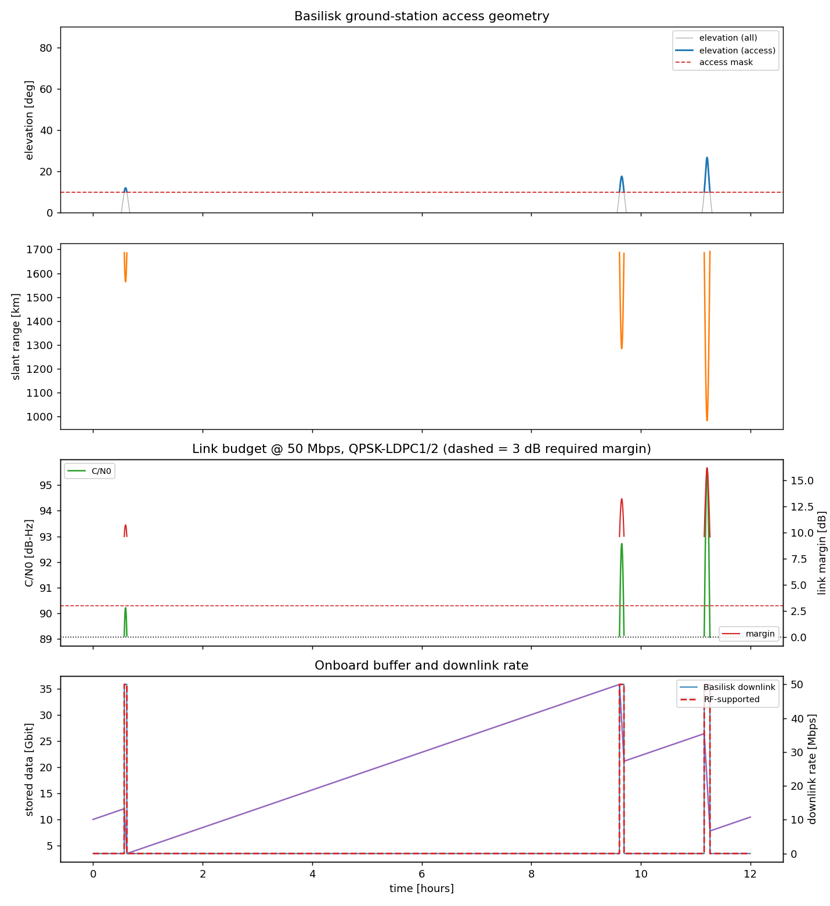
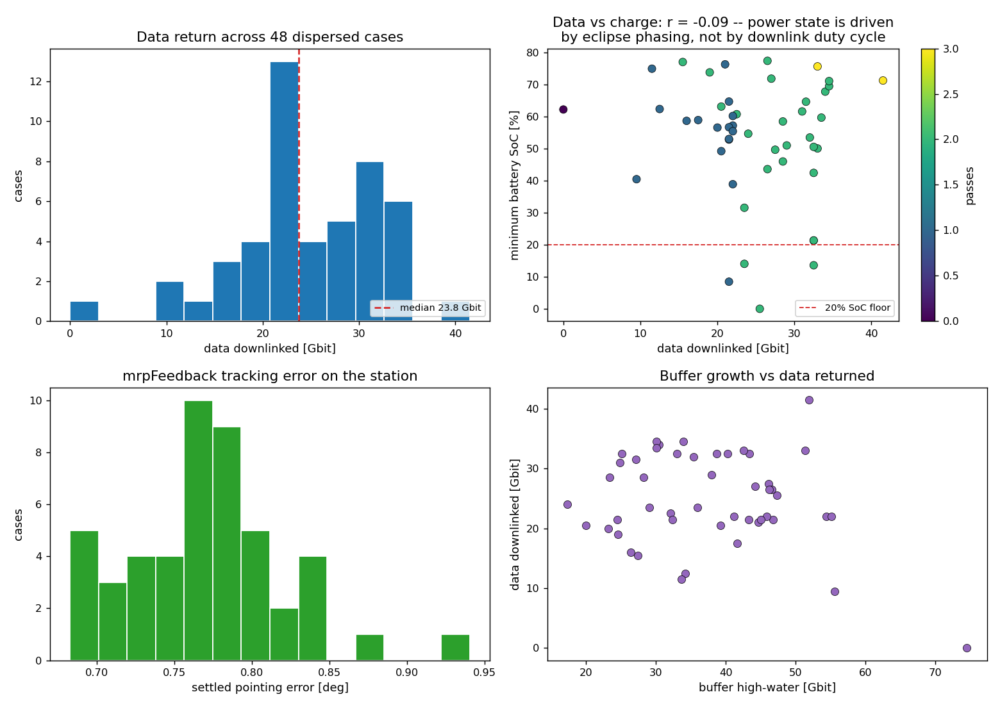

# basilisk-link-budget

Tests for the ground-station and downlink modules in [Basilisk](https://avslab.github.io/basilisk/) (AVS Lab, CU Boulder), plus an RF link budget to check whether the data volume Basilisk reports could actually get through the radio.

I started this because I wanted to use Basilisk for downlink planning and wasn't sure how far to trust the data-volume numbers. Looking at the source, the access/data chain is:

```
spacecraft -> groundLocation -(AccessMsg)-> spaceToGroundTransmitter
simpleInstrument -(DataNodeUsageMsg)-> storage unit <-(downlink)
```

`groundLocation` grants access on geometry only (elevation above a mask, optional max range, see `groundLocation.cpp`), and `spaceToGroundTransmitter` then downlinks at its full baud rate for the whole window. Basilisk does have an RF model (`simpleAntenna` + `linkBudget` in `src/simulation/communication/`, marked beta), but it isn't connected to the access/transmitter chain. So nothing in that chain checks whether the link closes at 10° elevation and ~1900 km slant range.

This repo does two things:

1. Checks what Basilisk computes (slant range, elevation, access windows, data bookkeeping) against an independent analytic model.
2. Runs a link budget along the same passes and compares the geometry-limited volume Basilisk reports with the volume the radio can support.

Tested with `bsk` 2.11.1 on macOS arm64, Python 3.13: **99 tests pass**.

## Layout

| Path | Needs Basilisk | Contents |
|---|---|---|
| `linkbudget/rf.py` | no | EIRP, FSPL, atmospheric loss, G/T, C/N0, Eb/N0, margin, Shannon limit |
| `linkbudget/geometry.py` | no | Reference model: Kepler propagation + spherical-trig access |
| `linkbudget/scenario.py` | yes | The Basilisk scenario (plus an analytic stand-in) |
| `linkbudget/analysis.py` | no | Applies the budget to telemetry, pass summaries, plots |
| `run_link_budget.py` | optional | Command-line driver |
| `showcase/mission_campaign.py` | yes | 6-DOF Monte Carlo data-return campaign (see below) |
| `tests/` | mixed | Test suite |

The reference geometry is written differently from Basilisk on purpose. Basilisk builds the line-of-sight vector and rotates it through `dcm_LP * dcm_PN`; `geometry.py` solves Kepler's equation and uses the law of cosines. If two different formulations agree to machine precision, that means something. Two copies of the same formulation agreeing doesn't.

## Running

```bash
pip install -r requirements.txt
pip install bsk          # Basilisk wheels (import name is "Basilisk")
python -m pytest tests/ -q
```

Note: the PyPI package is `bsk`. `pip install basilisk` installs an unrelated NoSQL library from 2014, and on macOS it can shadow the real `Basilisk` import.

Without Basilisk, the 59 non-simulator tests still run and the rest are skipped. The pipeline also runs on the analytic model alone:

```bash
python run_link_budget.py --synthetic --plots out/
```

## Reference scenario

- 500 km sun-synchronous orbit (i = 97.4°, RAAN = 60°), 12 h at 1 s steps
- Ground station at CU Boulder (40.009971 N, 105.243895 W, 1624 m), the same coordinates Basilisk's own `groundLocation` unit test uses
- 10° elevation mask, giving three passes with different geometry (peak elevations 12°, 18°, 27°)
- X-band 8.2 GHz, 5 W, 6 dBi spacecraft antenna, 5.4 m dish at 60% efficiency, QPSK + LDPC 1/2 at 50 Mbps, 3 dB required margin

Earth rotation comes from a small Python `SysModel` that writes `SpicePlanetStateMsg` directly instead of going through SPICE. No kernels needed, and the planet attitude is an exact function of time that `geometry.py` can reproduce, which is what makes the tight tolerances possible.

## What gets tested

**`test_rf_math.py`** (no Basilisk). The link budget checking itself, so that a failure in the simulator tests points at the simulator: FSPL against `32.44 + 20log10(d_km) + 20log10(f_MHz)`, the 228.6 dB Boltzmann term, +6.02 dB per doubling of range/frequency/dish diameter, -3.01 dB per doubling of data rate, dish gain vs. the aperture formula, cosecant atmospheric loss, T_sys increasing toward the horizon, and the supportable rate staying below Shannon at the bandwidth it would occupy.

**`test_geometry_truth.py`** (no Basilisk). Energy and angular momentum conservation, orbit closure after one period, Kepler solver inversion, site lat/lon round-trip, DCM orthonormality, `dcm_dot` vs. finite difference, and the spherical-trig access check against the vector formulation on random geometry.

**`test_bsk_groundlocation.py`**. Basilisk's access module vs. the reference model:
- slant range agrees to `rtol=1e-12`, elevation to `1e-9` rad
- site inertial track matches the commanded Earth rotation to 1 mm
- site radius is exactly `planetRadius + altitude` (`LLA2PCPF` uses a sphere)
- integrated trajectory within 5 km of the Kepler solution over 12 h
- `hasAccess` matches the mask predicate at every sample; `range_dot` matches the numerical derivative of range

**`test_bsk_comm_downlink.py`**. Transmitter and storage unit:
- no downlink outside access windows; rate is always 0 or `-nodeBaudRate`
- transmitter waits for a full packet; bits are conserved over the run and step by step
- with the nominal radio, the link closes on every granted sample and the RF-limited volume equals Basilisk's exactly
- with the transmitter dropped to 0.05 W, the link budget rejects all of the volume while Basilisk's reported volume doesn't change
- at 600 Mbps the link needs a 19.2° mask, but Basilisk grants access from 10°, so a lot of granted samples can't be used

## Example output

```
 #   start [s]   dur [s]   max el    min rng   peak C/N0   worst mg   closed   BSK [Gb]   RF [Gb]   ACM [Gb]
 0        2050       175    12.0d      1564k        90.2        9.6     100%       8.75      8.75      47.53
 1       34600       300    17.6d      1284k        92.7        9.6     100%      15.00     15.00     120.86
 2       40170       380    26.7d       983k        95.7        9.6     100%      19.00     19.00     242.56

Basilisk (geometry-limited) volume :    42.75 Gbit
Link-budget-limited volume         :    42.75 Gbit
Adaptive-modcod potential          :   410.96 Gbit
```

The worst margin is 9.6 dB on every pass because the worst point is always the 10° crossing, not the peak. The last column is what a rate-adaptive radio could get: about 10x more, since 50 Mbps is sized for the worst case and the channel is much better near zenith.



## Monte Carlo campaign (`showcase/mission_campaign.py`)

A bigger scenario to try more of Basilisk: 48 dispersed cases of 12 h each, full 6-DOF with four reaction wheels, the `locationPointing -> mrpFeedback -> rwMotorTorque` FSW chain pointing the antenna (+Z) at Boulder, and coupled power and data models. The transmitter draws 42 W only while it's downlinking.

```bash
python showcase/mission_campaign.py --cases 48 --hours 12 --plot out/campaign.png
```

| Metric | min | median | max |
|---|---|---|---|
| Data downlinked [Gbit] | 0.00 | 23.75 | 41.50 |
| Buffer high-water [Gbit] | 17.32 | 36.95 | 74.50 |
| Passes per case | 0 | 2 | 3 |
| Settled pointing error [deg] | 0.68 | 0.77 | 0.94 |
| Battery min SoC [%] | 0.00 | 56.91 | 77.37 |
| Peak wheel speed [rpm] | 232 | 305 | 428 |

576 spacecraft-hours ran in 152 s of wall clock on my laptop, and re-running case 0 reproduced the outputs bit for bit.

I expected a trade between data returned and battery charge, since pointing +Z at the station tilts the +Y solar array away from the Sun and the transmitter is a big load. It wasn't there: the correlation between data downlinked and minimum state of charge was r = -0.09. Downlink is only 10-14 minutes out of 12 hours, so eclipse timing and the initial attitude dominate the power state. Four cases dropped below 20% SoC and one fully depleted.



`--viz-case N` records a Vizard replay of one case (needs the separate Vizard app to view). Two things that tripped me up: `addLocation`'s `lla_GP` takes radians for lat/lon, and the replay file is written to a `_VizFiles/` subfolder with `_UnityViz.bin` appended to the name.

## Limitations

- The modcod thresholds in `rf.MODCODS` are typical textbook/CCSDS values, not from a specific modem.
- Atmospheric loss is a cosecant law (frozen below 5°) plus a flat rain allowance. There's no rain-fade statistics or availability calculation.
- `groundLocation` puts sites on a sphere, not WGS-84, so the reference model does too. At Boulder's latitude that's about 10 km of difference in site radius. This is a modelling choice in Basilisk, not a bug.

## Next step

The obvious next step is to test Basilisk's own `linkBudget` module, using `rf.py` as the reference the same way `geometry.py` is used for `groundLocation`:

- build `simpleAntenna` (spacecraft and ground) + `linkBudget` into the scenario and record `LinkBudgetMsgPayload`
- FSPL should agree to machine precision
- check the scaling laws (+6.02 dB per doubling of range and frequency, CNR increasing with elevation, `getCNR1()`/`getCNR2()` reciprocity for symmetric antennas)
- compare atmospheric loss as a trend only: `linkBudget` integrates ITU-R P.676 layer by layer, `rf.py` uses a cosecant law, so they should differ

Since `linkBudget` is beta, any disagreement needs checking on both sides before calling it a Basilisk bug.
